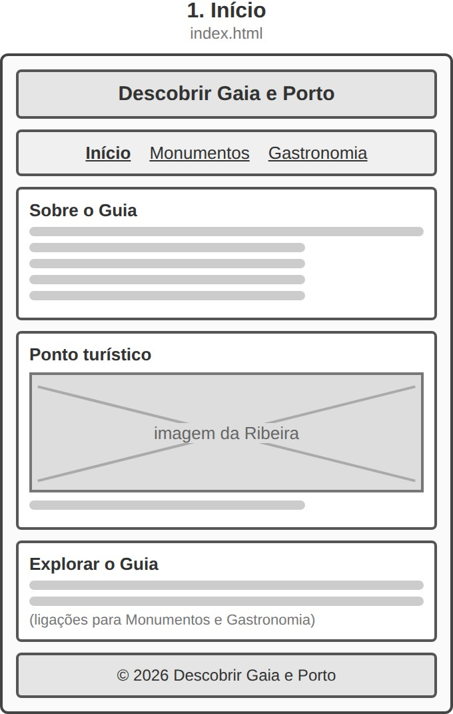
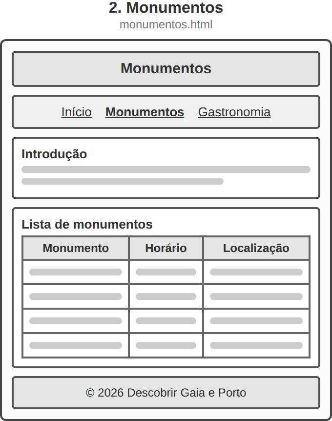
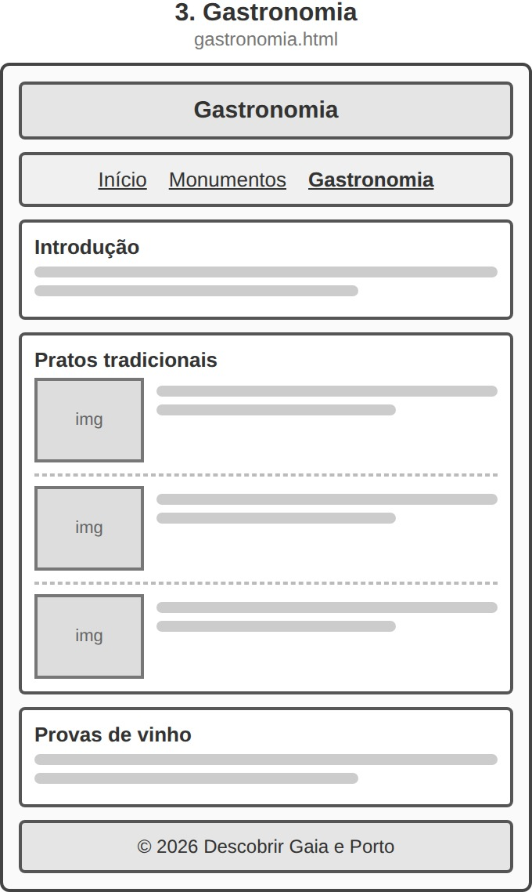

# Wireframes de Baixa Fidelidade — Descobrir Gaia & Porto

Este documento apresenta os esquemas de baixa fidelidade planeados para a estrutura e organização visual das três páginas do sítio web.

---

## 1. Início (`index.html`)

<figure>
  
  <figcaption>Esquema estrutural da página inicial com introdução, destaque e navegação.</figcaption>
</figure>

---

## 2. Monumentos (`monumentos.html`)

<figure>
  
  <figcaption>Esquema estrutural da página de monumentos e tabela de visitas.</figcaption>
</figure>

---

## 3. Gastronomia (`gastronomia.html`)

<figure>
  
  <figcaption>Esquema estrutural da página de gastronomia com apresentação de pratos e provas de vinho.</figcaption>
</figure>